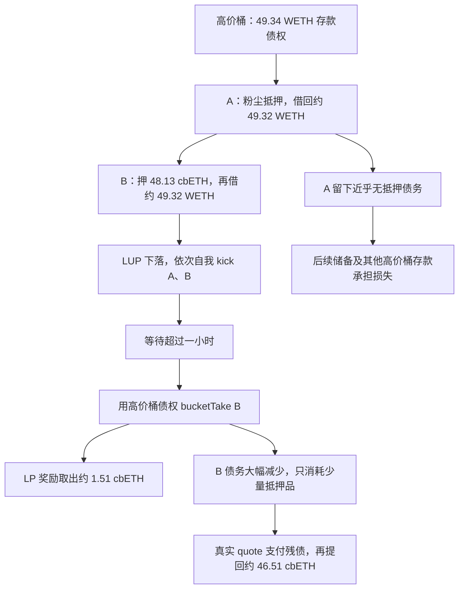

# Ajna 经济模型与历史利用链路

整理日期：2026-09-08。对象是本目录 cbETH/WETH 受害池的部署版实现，重点解释 2026-08-28 历史事件。已重新通过公开 RPC 获取两笔交易的回执、完整 callTracer、交易级 prestateTracer 及历史状态，并核对 Sourcify 源码。详见 [链上验证与受验证调用栈](<C:/Users/Jesse/Desktop/ExpAnalystic/9-2/Ajna Protocol Compromise 2/VERIFIED_CALLSTACK.md>)；没有在本地重新运行主网 fork。

**核心结论：攻击者用高价桶支持粉尘抵押借款，再把该桶尚未确认损失的存款债权按面值用于另一自有仓位的清算；大部分真实抵押品在后者债务清零后取回。高价桶的 LP 奖励帮助回收清算过程中转入桶的抵押品，剩余坏账则留在第一笔贷款中。**

**1. 版本和证据边界**

本地 [PROVENANCE.md](<C:/Users/Jesse/Desktop/ExpAnalystic/9-2/Ajna Protocol Compromise 2/ajna-v2/PROVENANCE.md>) 记录这套代码来自 Sourcify 验证源码，是 legacy 实现。本次用 eth_getCode 验证逻辑合约与受害池分别在区块 17,622,995、17,664,706 首次出现代码，确认 2023 年 7 月部署；49 个唯一源码文件与 Sourcify 元数据的 keccak256 全部一致。“ajna-v2”是本地目录名，不能据此套用公开 v1.0.0 或当前 FAQ 的公式。

外部 [BlockSec 事件分析](https://blocksec.com/blog/web3-security-cosmos-evm-moonwell-exploits) 将事件概括为清算中按面值消费受损存款债权，报告约 77.5 万美元、七个 Ethereum 池受影响。下文 cbETH/WETH 两笔交易的关键金额和调用顺序已重新用链上数据验证；七池总额及美元估值仍为报道口径。

**2. 经济模型：价格桶是出借人的风险报价**

每个池由 collateral 与 quote 两种资产组成。本例 collateral 是 cbETH，quote 是 WETH，所有价格单位都是 WETH/cbETH。

| 对象 | 投入及获得 | 收益与风险 |
| --- | --- | --- |
| 出借人 lender | 向指定价格桶存入 WETH，获得该桶 LP 份额 | 获得利息；可能按桶价接收 cbETH；坏账可能削减存款 |
| 借款人 borrower | 抵押 cbETH，借出 WETH | 获得流动性，承担利息、借款费与清算成本 |
| 清算发起人 kicker | 交 quote 保证金并 kick 不足额抵押贷款 | 成交价格合适时获奖；高于 neutral price 成交时可能损失保证金 |
| 清算执行人 taker | 付真实 quote 调用 take，或用桶存款执行 bucketTake | 获取抵押品或桶内 LP 奖励 |
| 储备 reserves | 由费用、部分利息等形成 | 吸收剩余坏账；可领取部分用于 AJNA 销毁拍卖 |

价格桶是预先确定的离散档位，相邻差约 0.5%。攻击者能选桶和改变存款分布，不能改写某个桶的固定价格。部署版近似公式：

```text
P(index) = 1.005^(4156 - index)
P(2000) ≈ 46,776.653369 WETH/cbETH
```

代码：[PoolHelper._priceAt](<C:/Users/Jesse/Desktop/ExpAnalystic/9-2/Ajna Protocol Compromise 2/ajna-v2/src/libraries/helpers/PoolHelper.sol:49>)。

从高价向低价累计桶存款，刚好覆盖池总债务的边际档位就是 LUP。新借款增加总债务，可能让 LUP 落到更低的桶。因此，即便外部 cbETH/WETH 现货价格不变，池内抵押能力也会变化。

| 变量 | 含义 | 本例应如何理解 |
| --- | --- | --- |
| P_b | 固定桶价 | 出借人接受抵押品的报价 |
| LUP | 最低被使用价格 | 由存款分布和总债务决定，非现货预言机 |
| TP = D/C | 单笔债务与抵押品之比 | 本部署版不足额抵押的边界 |
| HTP | 贷款堆中的最高 TP | 与出借人提款限制、计息范围有关 |
| MOMP | 覆盖平均贷款规模的边际桶价 | 清算启动时记录为 kickMomp |
| NP | 单笔贷款 neutral price | 决定 kicker 奖惩，也参与拍卖参考价 |
| P_a | 当前荷兰拍卖价 | 按 kick 时参考值与经过时间计算 |

本部署版 ERC20 借款满足 `C × LUP ≥ D` 即通过抵押检查；D 包含借款费、累计利息等应计债务。没有 1.04 系数。借款先增加债务、重算 LUP，再检查新仓位。代码：[抵押检查](<C:/Users/Jesse/Desktop/ExpAnalystic/9-2/Ajna Protocol Compromise 2/ajna-v2/src/libraries/helpers/PoolHelper.sol:158>)、[drawDebt](<C:/Users/Jesse/Desktop/ExpAnalystic/9-2/Ajna Protocol Compromise 2/ajna-v2/src/libraries/external/BorrowerActions.sol:197>)。

**关键账本区别：桶的 quote deposit 是存款债权，不是单独保管在该桶里的现金。** 借款会减少池真实 token 余额并增加债务，但不会把出借人的存款债权直接扣掉。正常时债权有现金和可回收贷款支撑；贷款已经经济性资不抵债而尚未被 settle 核销时，账面债权与可回收金额可以脱节。

桶份额按如下账面价值换算，省略定点精度和取整：

```text
桶账面价值 V_b = quoteDeposit + bucketCollateral × P_b
每 LP 账面价值 E = V_b / totalLP
```

因此 LP 的数值既不是 WETH 现金，也不是 cbETH 数量。代码：[Buckets.quoteTokensToLP](<C:/Users/Jesse/Desktop/ExpAnalystic/9-2/Ajna Protocol Compromise 2/ajna-v2/src/libraries/internal/Buckets.sol:145>)。

**3. 利息、费用、坏账与 AJNA 价值回流**

部署版利息以 inflator 累积：固定利率的一段时间内，债务近似按 `D(t)=D(0)×exp(r×t/365天)` 增长。常规利率更新间隔超过 12 小时，根据平滑后的实际利用率 MAU 与目标利用率 TU 判断维持、乘 1.1 或乘 0.9；这不是固定目标利用率的简单折线模型。代码另有低利用率下的利率重置分支。

| 项目 | 本地部署版规则 |
| --- | --- |
| 借款费 | 新借款 × max(r/52, 0.05%)，计入债务 |
| 未利用存款费 | 在代码规定的低于 LUP 存入/跨越 LUP 下移场景，费率 min(r/365, 10%) |
| 利息分配 | NIM = 15% × (1−min(MAU,1))^(1/3)，出借人分得剩余利息 |
| kick 罚金 | 在通过清算资格检查后，债务增加约三个月利息，即 D×r/4 |
| 首次 take 罚金 | 第一次 take 或 bucketTake 前，对债务增加 7% |
| kicker 保证金 | 债务的 1%–30%，具体由 TP 与 MOMP 关系决定 |

这里 NIM 不是固定 10%，存款费也不能直接用当前 FAQ 的“8 小时利息”替换。源码：[费用](<C:/Users/Jesse/Desktop/ExpAnalystic/9-2/Ajna Protocol Compromise 2/ajna-v2/src/libraries/helpers/PoolHelper.sol:117>)、[利率与分成](<C:/Users/Jesse/Desktop/ExpAnalystic/9-2/Ajna Protocol Compromise 2/ajna-v2/src/libraries/external/PoolCommons.sol:269>)、[kick](<C:/Users/Jesse/Desktop/ExpAnalystic/9-2/Ajna Protocol Compromise 2/ajna-v2/src/libraries/external/KickerActions.sol:309>)、[首次 take](<C:/Users/Jesse/Desktop/ExpAnalystic/9-2/Ajna Protocol Compromise 2/ajna-v2/src/libraries/external/TakerActions.sol:703>)。

常规清算尽量出售抵押品覆盖债务。到 settle 阶段，有抵押品时先用高价桶存款接收抵押品；抵押品耗尽仍有残债，先消耗可用储备，再从最高有存款的桶向下削减存款。于是高价出借既可能被动买入抵押品，也承担较靠前的坏账损失。代码：[SettlerActions.settlePoolDebt](<C:/Users/Jesse/Desktop/ExpAnalystic/9-2/Ajna Protocol Compromise 2/ajna-v2/src/libraries/external/SettlerActions.sol:100>)。

AJNA 是另一层经济机制，不是桶 LP。官方定义初始供应 10 亿且不可增发，用于资助计划投票；可领取储备通过拍卖换得 AJNA 并销毁，竞买人支付 AJNA、获得池的 quote token。它形成“协议收入 → 储备 → 部分储备拍卖 → AJNA 销毁”的价值回流，但持币并不等于持有桶存款债权。本次漏洞链路也不依赖 AJNA 代币操纵。[官方代币说明](https://faqs.ajna.finance/faqs/ajna-token)、[储备拍卖说明](https://faqs.ajna.finance/faqs/reserve-auctions)。

**4. 正常清算如何变成利用入口**

部署版拍卖价格为：

```text
R = max(kickMomp, NP)
P_a(t) = 32 × R × 2^(-max(t/1小时 - 1, 0))
```

首小时价格锁定，且 take/bucketTake 需要等待超过一小时。之后每小时减半。这里不能使用“256 倍起拍、20 分钟减半”的另一套公式。代码：[拍卖价格](<C:/Users/Jesse/Desktop/ExpAnalystic/9-2/Ajna Protocol Compromise 2/ajna-v2/src/libraries/helpers/PoolHelper.sol:354>)、[冷却检查](<C:/Users/Jesse/Desktop/ExpAnalystic/9-2/Ajna Protocol Compromise 2/ajna-v2/src/libraries/external/TakerActions.sol:697>)。

| 入口 | 债务的支付来源 | 抵押品流向 |
| --- | --- | --- |
| take | 调用方支付真实 quote | 转给 taker 指定接收方 |
| bucketTake(..., true, index) | 消耗指定桶的存款债权，以桶价计算 | 记入桶 |
| bucketTake(..., false, index) | 消耗指定桶的存款债权，以拍卖价计算 | 记入桶，另向 taker 铸造价差 LP |

`false` 分支只要求 `P_a ≤ P_b`，并不要求 `P_a ≤ 外部市场价`。当拍卖价远高于市价、桶价更高时，该检查仍会通过。

在本次 kicker 被罚而无奖励的分支，忽略取整：

```text
消费存款债权 q
拍卖抵押品减少 c = q / P_a
目标 borrower 债务减少 q
taker 奖励的 quote 计价价值 = c × (P_b - P_a)
taker 新 LP = 上述账面价值 / E_before
```

代码分别位于 [_takeBucket](<C:/Users/Jesse/Desktop/ExpAnalystic/9-2/Ajna Protocol Compromise 2/ajna-v2/src/libraries/external/TakerActions.sol:431>)、[_calculateTakeFlowsAndBondChange](<C:/Users/Jesse/Desktop/ExpAnalystic/9-2/Ajna Protocol Compromise 2/ajna-v2/src/libraries/external/TakerActions.sol:734>)、[_rewardBucketTake](<C:/Users/Jesse/Desktop/ExpAnalystic/9-2/Ajna Protocol Compromise 2/ajna-v2/src/libraries/external/TakerActions.sol:606>)。桶存款在后者第 662 行扣减，目标 borrower 债务在 [bucketTake](<C:/Users/Jesse/Desktop/ExpAnalystic/9-2/Ajna Protocol Compromise 2/ajna-v2/src/libraries/external/TakerActions.sol:166>) 同步扣减。

每一腿可在账面上配平，但调用方不必带来新的 quote 现金。攻击者利用的正是：尚未承担坏账的高价桶债权，可先拿去注销另一笔足额资产支撑的自有贷款。

**5. 历史利用链路：两个仓位、两笔交易**

受害池：`0xad24FC773e125Edb223C38a39657cB64bc7C178e`。攻击主合约兼任粉尘 borrower A 与 kicker；另一攻击方合约 `0x02D329…6F5f` 是大额抵押 borrower B。

以下金额为重新取得的 trace 与事件解码后的近似数；逐 wei 数字和帧号见 [验证报告](<C:/Users/Jesse/Desktop/ExpAnalystic/9-2/Ajna Protocol Compromise 2/VERIFIED_CALLSTACK.md>)。

| 顺序 | 操作 | 经济效果 |
| --- | --- | --- |
| Setup 1 | Balancer 闪贷约 105 WETH；花约 54.8925 WETH 买 48.1284 cbETH | 准备 B 的真实抵押品 |
| Setup 2 | 在 bucket 2000 存 49.343733 WETH | 建立极高报价及相应存款债权 |
| Setup 3 | A 押 0.0010548795 cbETH，借出 49.319073 WETH | 债务含费约 49.343733；按高 LUP 过检，经济上只有粉尘支撑 |
| Setup 4 | B 押 48.128429 cbETH，再借出 49.319073 WETH | 总债务增大，LUP 降到约 1.025251；A 已严重水下 |
| Setup 5 | 先 kick A，再 kick B，分别交约 0.493437 WETH bond | A 的 kick 罚金增加总债务、进一步压低 LUP，使边界 B 可清算；归还本笔闪贷 |
| 等待 | 约 61 分钟 | 通过一小时冷却，但拍卖价仍约 32.63 WETH/cbETH |
| Exploit 1 | 对 B 调用 bucketTake(..., false, 2000) | 消费约 49.343740 WETH 存款债权，减去 B 相应债务；只转出约 1.512187 cbETH 到桶 |
| Exploit 2 | taker 获约 70,685.7 LP，随后 removeCollateral | 取出约 1.511132 cbETH，出售约得 1.719391 WETH |
| Exploit 3 | 闪贷约 4 WETH，以 take 支付约 3.474032 WETH | 得约 0.106465 cbETH，同时清零 B 剩余债务 |
| Exploit 4 | B 调 repayDebt，quoteRepaid=0，提约 46.509777 cbETH | 大部分原始抵押品重回攻击方 |
| Exploit 5 | 出售部分 cbETH 还闪贷 | 保留剩余 cbETH；A 的粉尘坏账没有在本笔被清偿 |

链上 F060 确认第二次调用为 `bucketTake(B, true, 2000)`，返回 `InsufficientLiquidity()`，之后才执行 take。桶并非严格归零：区块末剩 3 wei WETH，远不足以按桶价买入 1 wei cbETH。因此不能写成第二次仍为 false、存款精确清零或同桶可无限重复提取。

**A 为什么能以粉尘抵押借款：精确边界核算。** Setup 的 `debtInfo()` 显示原有池债务为 0。攻击者先往 bucket 2000 存 49.343732556986936488 WETH，而 A 的借款加 0.05% 发起费后债务为 49.343732556985936487 WETH，仍被该高价桶存款完全覆盖，所以新 LUP 为 46,776.653369145271678115 WETH/cbETH。按部署版 `Maths.wmul(C,LUP)` 四舍五入计算，0.001054879496563856 cbETH 的账面抵押价值为 49.343732556985962801 WETH，比债务高 **26,314 wei WETH**，合法通过 `>=` 检查。旧历史摘要中“逐 wei 相等”不精确，应为极接近边界且略高于债务。F123 的 `borrowerInfo(A)` 返回值独立确认上述债务和抵押品。单看这一步主要是借回刚存入的资金，完整收益来自后续 B 的清算与坏账转移。

**B 为什么能被 kick：直接验证清算当刻的 LUP。** 新增解码 setup F129/F134 的库级 `KickResult` 与 `PoolState`，按已验证源码中的结构体字段顺序解释返回值和输入。池总存款为 98.687749844521015658 WETH，两笔借款后的总债务为 98.687465114971872974；A 的 kick 罚金使总债务增加到 98.706127754155146617，超过所有桶存款。F129 因此返回 LUP=`MIN_PRICE`=0.000000099836282890 WETH/cbETH，且 F134 输入的池债务与 F129 输出一致。B 的 48.128429404435444755 cbETH 按该 LUP 只值 0.000004804963493073 WETH，远低于其加本次 kick 罚金前的 49.343732557985936487 WETH 债务，故清算检查合法通过。**这里是 LUP 降到底价，不是仅下降一档；32.63 是稍后拍卖的价格，不是此时的 LUP 或外部现货价。** 原始字段与断言见 [kick 边界核验](<C:/Users/Jesse/Desktop/ExpAnalystic/9-2/Ajna Protocol Compromise 2/verification/kick_boundary_verification.json>)。



交易锚点：[Setup 交易](https://etherscan.io/tx/0x8a8793963c0ef443b9a396665c3c185ded132d5f99daf7c99e87125597016e64)，区块 25,854,585 / 交易索引 63；[Exploit 交易](https://etherscan.io/tx/0x12dfde527ef62882bfabb64362c9ae0e6bfb628363bd298d0d0956c9a114e4f5)，区块 25,854,888 / 交易索引 6。RPC 时间戳为 2026-08-28 15:18:35 和 16:19:11 UTC，相隔 3,636 秒。完整调用栈分别为 145 帧、127 帧，各有 30 条回执事件。

**6. 为什么自存、自借、自清算仍能赚走别人的钱**

高价桶正常应该最先为 A 的坏账承担损失。但在该损失被核销前，攻击者把桶存款债权消耗在 B 的清算上：债权按面值注销了 B 的债务，B 的真实抵押品因此获释；高价桶 quote 只剩 3 wei，原 LP 主要变成对约 0.00105488 cbETH 粉尘的权益，剩余风险向其他桶转移。本次验证截止 exploit，未进一步核验后续最终 settle 对各桶的损失分配。

用极简例子说明，忽略费用、罚金和价格换算，设抵押品市场价值正好为 50 quote：

| 状态 | 池现金 | A 的债务 / 可回收价值 | B 的债务 / 抵押品市值 | 尚存存款债权 |
| --- | ---: | --- | --- | --- |
| 原出借人存 50 | 50 | 0 / 0 | 0 / 0 | 原出借人 50 |
| 攻击者高价桶存 50，A 借走 50 | 50 | 50 / ≈0 | 0 / 0 | 原出借人 50 + 攻击桶 50 |
| B 押价值 50 的抵押品，再借走 50 | 0 | 50 / ≈0 | 50 / 50 | 原出借人 50 + 攻击桶 50 |
| 用攻击桶债权抵掉 B 债务、回收抵押品 | 0 | 50 / ≈0 | 0 / 0 | 只剩原出借人 50 |

攻击者先后存入 50 quote 和价值 50 的抵押品，拿走 100 quote，并回收抵押品，净收益约 50；原出借人的 50 债权最终只剩 A 的粉尘抵押支撑。实际攻击多了手续费、保证金损失、残债支付、交易滑点及一小时等待。

**LP 奖励的作用是回收清算时划入桶的抵押品，不是单独凭空铸出 70,685 WETH。** 设原桶仅有 q 存款，`c=q/P_a`，原 LP 为 L，奖励 LP 为 R，则：

```text
R/L = (P_b-P_a)/P_a
奖励 LP 占清算后总 LP 的比例 = 1 - P_a/P_b
```

本例约为 `1−32.63/46776.65 ≈ 99.93%`。因而 taker 的新 LP 几乎覆盖转入桶的全部 1.512187 cbETH；原高价桶 LP 的剩余权益只值极少 cbETH。这说明价差奖励放大了回收效果，但不能只凭 LP 数字大就判断损失规模。

**主要资产释放来自 B 的债务注销。** 数值上：

```text
B 首次 take 前债务 ≈ 49.362395 × 1.07
桶债权抵销          ≈ 49.343740
剩余债务            ≈ 3.4740 WETH

B 原抵押品 48.128429
− bucketTake 转入桶 1.512187
− take 取走 0.106465
≈ 最后 repayDebt 提回 46.509777 cbETH
```

kicker 的 0.493437 WETH bond 被罚没，并未阻断整套组合收益。独立 kicker 通常不会乐意在高于 NP 的价格成交，但当 lender、borrower、kicker、taker 由同一方控制时，单个角色亏损仍可能换来整体盈利。

**7. 损益口径与易误读点**

交易级存储差分确认，exploit 结束后攻击主合约保留 43.751371388571168932 cbETH，EOA 增加 1.719390871405544952 WETH，主合约消耗 0.215026316401210751 WETH。这个单笔余额变化未扣 setup 成本，不能直接视为完整攻击净利润。

本次已将 EOA、Main、Helper、B 和兑换模块的两笔交易合并：**净增 43.751371388571168932 cbETH、净减 5.080609128594455048 WETH**；两笔 gas 合计 0.008082922193349390 ETH。池两笔净变化为 **−44.833506635564403832 WETH、+0.002109759149587776 cbETH**。token 数量与 prestateTracer 余额槽差分相符。美元利润仍需统一估值，并处理后续未检查交易、残留 LP 和未领取保证金；不能把 cbETH 按 1:1 WETH 精确估值。

同时，**不能把 A 的坏账金额与 B 取出的全部抵押品市值简单相加为池净损失**：B 的抵押品原本就是攻击者投入，资金流和坏账是同一套资产负债变化的不同观察面。

本次阅读确认的更正与边界：

- 桶价格是固定档位；操纵的是存款分布和 LUP，不是修改 index 2000 的价格公式。
- 本部署版是 32 倍参考价起拍、首小时锁价；旧 README 中“256 倍起拍、一小时三次减半”与代码不符。
- 每次 kick 先检查不足额抵押，再加本次罚金。历史摘要中的 B 因前一笔 A 的 kick 罚金跨界，不能说 B 靠自己的 kick 罚金获得清算资格。
- 本部署版抵押检查无 1.04；增加 1.04 会改变原样 setup 的可行性，但不能仅凭此证明消除了同类经济攻击。
- 无预言机是设计背景。可利用的组合在于受损债权仍可按面值结算、坏账确认顺序、高价清算及关联角色可以回收抵押品。
- `bucketInfo` 第五项是 `Deposits.scale`，不是 LP 汇率；本次独立 `bucketExchangeRate(2000)` 查询的攻击前结果为 1。`borrowerInfo` 第一项是 t0Debt，需要乘 inflator 才是应计债务。
- 本地 PoC 是在 setup 已完成的历史 fork 上调用已有攻击合约，本次没有运行。本次证据来自重新获取的公共 RPC trace、回执及状态，不能称为本地 PoC 复现成功。

**8. 继续审计应验证的性质**

关于“根因在哪、为何新池或其他池没有被攻击”，见 [根因代码与影响范围边界](<C:/Users/Jesse/Desktop/ExpAnalystic/9-2/Ajna Protocol Compromise 2/ROOT_CAUSE_AND_SCOPE.md>)。已对比公开 v1.0.0；确认原样借款输入受 1.04 检查阻止，但没有证据据此认定所有新版或其他池均不受影响。

| 性质 | 核心问题 | 建议验证方式 |
| --- | --- | --- |
| 坏账承担顺序 | 最先承担坏账的存款能否在核销前退出损失队列？ | 同一前置状态比较先处理 A 与先 bucketTake B 后处理 A |
| 整体偿付能力 | 按面值抵销债务后，其他出借人的可回收净资产是否恶化？ | 对池现金、债务、抵押品可回收价值和 LP 负债做全局核算 |
| 角色合并收益 | kicker 的损失能否被关联 borrower/taker 的收益覆盖？ | 将所有攻击方地址合并计算收益，而非只看单次 take |
| LP 奖励兑付 | 自选高桶价产生的奖励，是否能立刻提走真实抵押品？ | 覆盖极端 P_b/P_a、桶存款耗尽及同交易赎回 |
| 版本修正有效性 | 抵押系数或奖励上限是否仅提高成本？ | 改变参数后重新搜索可行组合并做收益核算 |

这些是后续验证方向，不是已经实施或证明有效的修复。完整源码入口为 [ERC20Pool](<C:/Users/Jesse/Desktop/ExpAnalystic/9-2/Ajna Protocol Compromise 2/ajna-v2/src/ERC20Pool.sol:131>)，建议阅读顺序为 drawDebt → kick → bucketTake → _rewardBucketTake → take → repayDebt → settle。
